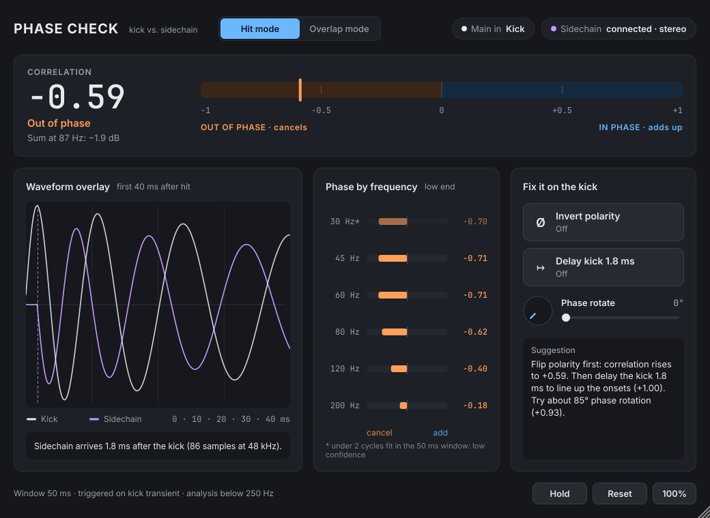
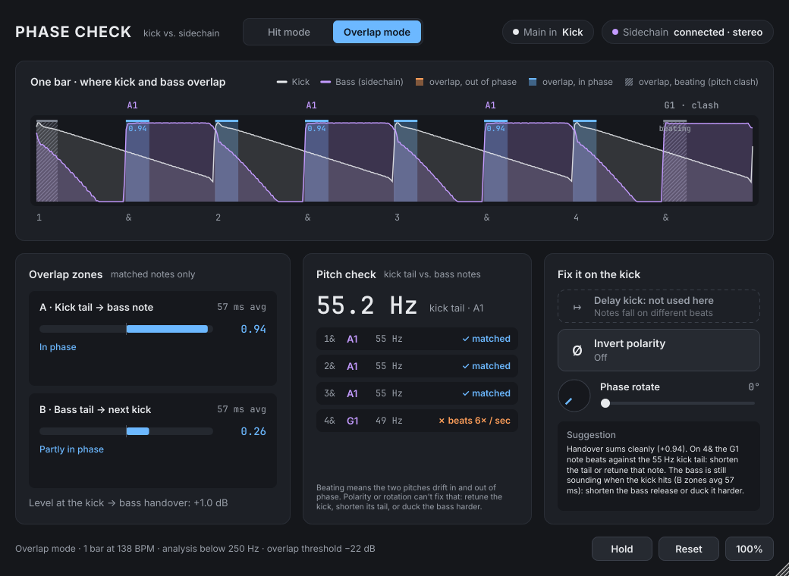

# Phase Check

**Kick vs. sidechain phase analyser and fixer** — a VST3 plug-in for Windows (plus a Standalone app for quick UI testing).

Put Phase Check on your **kick** track, send a second signal (bass, another kick mic, a sub layer) into its **Sidechain** input, and it will:

1. **Show** whether kick and sidechain are in or out of phase: an overall correlation meter, a waveform overlay of each hit, and phase per low-end band.
2. **Measure** the time offset between them and predict what each fix would do.
3. **Fix the kick** (it can't change the other track): polarity invert, delay, and a phase-rotation knob.

| Hit mode | Overlap mode |
|---|---|
|  |  |

---

## 1. Get the plug-in

### Option A: download a ready-made build (no coding)

Every push to this repository is built on Windows by GitHub Actions.

1. On GitHub, open the **Actions** tab → **Build Windows VST3** → the most recent green run.
2. At the bottom, under **Artifacts**, download **PhaseCheck-Windows-x64** and unzip it.
3. Copy the whole **`Phase Check.vst3`** folder into
   `C:\Program Files\Common Files\VST3\`
   (Windows will ask for administrator permission.)

If a release has been tagged (`v1.0.0` etc.), the same zip is attached to the **Releases** page.

### Option B: build it yourself

One-time setup:

1. Install **Visual Studio 2022 Community** (free) from <https://visualstudio.microsoft.com/>. In the installer tick **"Desktop development with C++"**. This also installs CMake.
2. Install **Git for Windows** from <https://git-scm.com/download/win> (keep the defaults).

Build (open **"x64 Native Tools Command Prompt for VS 2022"** from the Start menu):

```bat
git clone https://github.com/garymaguiremusic-pixel/Phase.git
cd Phase
cmake -B build -A x64
cmake --build build --config Release
ctest --test-dir build -C Release
```

The first configure downloads JUCE 8, so it needs an internet connection and takes a few minutes.

When it finishes, the plug-in is at

```
build\PhaseCheck_artefacts\Release\VST3\Phase Check.vst3
```

and the Standalone app at `build\PhaseCheck_artefacts\Release\Standalone\Phase Check.exe`.

To have the build copy the plug-in into `C:\Program Files\Common Files\VST3` automatically, run the command prompt **as Administrator** and configure with:

```bat
cmake -B build -A x64 -DPHASECHECK_COPY_PLUGIN=ON
```

---

## 2. Set it up in Studio Pro

1. **Rescan plug-ins**: in Studio Pro's *Options › Locations › VST Plug-Ins*, make sure `C:\Program Files\Common Files\VST3` is listed, then restart Studio Pro (it scans new plug-ins on start-up).
2. Put **Phase Check** on the **kick** track (it's an effect under *Analyzer*).
3. On the plug-in's header, click Studio Pro's **sidechain button** to enable the sidechain input.
4. On the **bass** (or other) track, add a **Send** (or set its output) to **"Phase Check › Sidechain"**. A pre-fader send keeps the analysis independent of the bass fader.
5. Press **play**. The header pill should change from *No sidechain signal* to *connected · stereo* (or *mono*).

### Which mode?

- **Hit mode**: for sounds that hit together: kick in/out mics, kick + sample layer, kick + a bass note on the same beat.
- **Overlap mode**: for kick-and-offbeat-bass patterns (trance, techno, house). Overlap mode follows the song's tempo, so **the song must be playing**. If the transport is stopped it estimates the tempo from the kick hits and says so in the footer.

The mode only changes the analysis and display, never the audio (except that the kick delay is not used in Overlap mode).

---

## 3. Reading the display

### Header
- **Hit mode / Overlap mode**: switches the analysis (also automatable as the *Mode* parameter).
- **● Main in Kick**: the plug-in's main input is the kick.
- **● Sidechain …**: *connected · stereo*, *connected · mono*, or **No sidechain signal** (disconnected, or below −60 dBFS for more than 1 second). With no sidechain signal every readout is greyed out and shows "–"; old numbers are never shown as if they were live.

### Hit mode
- **Correlation**: −1 … +1 between kick and sidechain below 250 Hz, averaged over the last ~8 kick hits.
  - **In phase** (≥ 0.5), **Partly in phase** (0 … 0.5), **Partly out of phase** (−0.5 … 0), **Out of phase** (< −0.5).
  - **Sum at NN Hz**: how much louder (+) or quieter (−) kick + sidechain is than the kick alone at the kick's fundamental. Negative = the low end cancels.
  - The meter: orange half = cancelling, blue half = adding up.
- **Waveform overlay**: the last hit, first 40 ms. Kick in light grey, sidechain in purple, the dashed purple line is where the sidechain starts. The line underneath tells you the offset in ms and samples ("Sidechain arrives 1.8 ms after the kick").
- **Phase by frequency**: correlation in six bands (30, 45, 60, 80, 120, 200 Hz). Bars grow left (orange, cancel) or right (blue, add). A band shows "–" when one of the signals has almost no energy there. The 30 Hz band is marked `*`: fewer than two cycles fit in the 50 ms window, so treat it as a rough guide.

### Overlap mode
- **One bar timeline**: the last full bar. Grey = kick envelope, purple = bass envelope. Coloured bands are where both are sounding (above −22 dB of their own peak): **orange** = out of phase, **blue** = in phase, **grey stripes** = the pitches don't match (beating). Bass note names sit above their onsets.
- **Overlap zones** (matched notes only):
  - **A · Kick tail → bass note**: the bass starts while the kick is still ringing.
  - **B · Bass tail → next kick**: the bass is still sounding when the next kick hits.
  - Each shows the correlation inside the overlaps (smoothed over the last 4 bars) and the average zone length. **Level at the kick → bass handover** is how much louder/quieter the sum is than the louder of the two.
- **Pitch check**: the kick tail's pitch (e.g. *55.0 Hz · A1*) and each bass note. **✓ matched** = within ±1.5 Hz or ±25 cents. **✗ beats N× / sec** = the two pitches drift in and out of phase N times a second. Polarity or rotation can't fix that: retune the kick, shorten its tail, or duck the bass harder. Beating zones are left out of the correlation numbers.

### Fix it on the kick (both modes)
- **Ø Invert polarity**: flips the kick (click-free 10 ms crossfade).
- **↦ Delay kick X ms**: shows the measured offset. Turning it on delays the kick by that amount so both hits start together. It is disabled (hover for the reason) when the offset is unclear or the sidechain is *earlier* than the kick: the kick can only be delayed, never moved earlier, so delay the other track with Studio Pro's **Track Delay** instead. In Overlap mode the delay is not used ("Notes fall on different beats"); your delay value is kept for when you go back to Hit mode.
- **Phase rotate**: shifts the low-end phase of the kick by 0–180° without moving its timing (knob and slider are linked; double-click resets to 0°; mouse wheel and arrow keys work). Best for kick vs. bass.
- **Suggestion**: plain-language advice with predicted results, e.g. *"Flip polarity first: correlation rises to +0.71. Then delay the kick 1.8 ms to line up the onsets (+0.94)."*

### Footer
- What the analysis is doing (window length, tempo, thresholds).
- **Hold** freezes all displays. **Reset** clears the averages and resets invert, delay and rotate.
- **100%**: window size (75 / 100 / 125 / 150 %). You can also right-click anywhere, or drag the bottom-right corner to any size. The size is saved with the song.

---

## 4. Limitations (please read)

- **Kick vs. bass readings change per note.** A bass line is not a fixed copy of the kick, so Hit-mode numbers move from hit to hit. When they vary a lot the suggestion says so. Trust your ears in mono.
- **Bands below about 40 Hz are less reliable** with the 50 ms window (fewer than two cycles).
- **The kick can only be delayed, never advanced.** If the sidechain is early, delay the other track in Studio Pro.
- **Phase rotation and its "common phase":** the rotator is a pair of IIR all-pass filters 90° apart (designed per sample rate, accurate within 0.3° from 20 Hz to 20 kHz). Both branches share the same frequency-dependent all-pass phase, so any setting above 0° also adds that common phase shift to the kick; only the *difference* between settings is a pure rotation. At exactly 0° the rotator is bypassed and the plug-in is bit-transparent; leaving or returning to 0° crossfades over 20 ms. This is why the best angle is found by measuring, not by theory: the suggestion sweeps 0–180° on the actual signals.
- **Overlap mode needs a steady pattern.** It analyses whole bars from the host tempo; with the transport stopped it guesses the tempo from the kick (assuming 4/4 and a kick on every beat).
- Analysis is a mono sum of each input, below 250 Hz.
- The plug-in reports **0 latency**: the delay is intentional and the rotator is IIR.

---

## 5. Technical notes

- **Stack:** JUCE 8.0.15 (fetched by CMake `FetchContent`), C++20, CMake. Formats: **VST3** and **Standalone**, Windows x64. Plug-in name *Phase Check*, manufacturer *PhaseCheck Audio*, codes `PhCk` / `PhC1`, VST3 category *Fx | Analyzer*.
- **Buses:** main in/out mono or stereo (in = out); one input bus "Sidechain", mono or stereo, enabled by default. The sidechain is never output.
- **Audio path** (real-time safe, no allocation or locks, `ScopedNoDenormals`): phase rotate → polarity → delay (4-point Lagrange fractional delay, smoothed). Parameters: `invert`, `delayMs` (0–20 ms, 0.01 step), `delayOn`, `rotate` (0–180°, 1° step), `mode` (Hit / Overlap). All automatable and saved with the session.
- **Analysis** runs on a background thread. The audio thread copies the processed kick, the unprocessed kick, the sidechain and the host transport into lock-free FIFOs; the GUI redraws at 30 fps from a snapshot only.
- **Source layout:** `Source/dsp` (rotator, delay, kick chain), `Source/analysis` (hit & overlap analysis, suggestion text, threading), `Source/gui` (look and feel, views), `tests/` (unit tests), `tools/` (screenshot renderer for development).

### Tests

`ctest` runs `PhaseCheckTests` (114 checks), covering:
- synthetic kick (55 Hz with a pitch drop from 145 Hz) vs. an inverted copy delayed 1.8 ms at 44.1 and 48 kHz: offset within ±0.02 ms, clearly negative correlation, "flip + delay" prediction > 0.9, and the real kick chain with that fix applied reads > +0.95;
- identical → +1 / inverted → −1, offset ≈ 0;
- rotator at 90°: 90° ± 2° at 60 Hz, magnitude within ±0.1 dB from 30 Hz to 10 kHz (44.1/48/96 kHz), bit-transparent at 0° (and again after returning to 0°); exact polarity inversion, click-free ramp, fractional delay accuracy;
- silent or missing sidechain → "No sidechain signal", greyed out, no NaNs, averages cleared;
- Overlap mode on a synthetic 138 BPM bar (kick tail 55 Hz, bass A1 A1 A1 G1, ducked): 4 type-A and 3–4 type-B zones with durations within ±5 ms of the analytic ground truth; kick tail 55 ± 1 Hz; A1 matched, G1 beating at ≈ 6 Hz and excluded; inverting the bass flips the type-A sign; no bass → "no overlap" (not NaN); host-tempo bar tracking; tempo fallback from kick hits within ±1 BPM.

The GitHub Actions workflow builds Release on Windows, runs the tests and **pluginval at strictness level 8** on the VST3, and uploads the zip.

### Build options

| Option | Default | |
|---|---|---|
| `PHASECHECK_COPY_PLUGIN` | OFF | Copy the VST3 to the system folder after building (Administrator prompt). |
| `PHASECHECK_BUILD_TESTS` | ON | Build the unit tests. |
| `PHASECHECK_BUILD_AS_INSTRUMENT` | OFF | Register as an *instrument* instead of an effect (see below). |
| `PHASECHECK_BUILD_SCREENSHOT_TOOL` | OFF | Developer tool that renders the screenshots above with synthetic audio. |

**Effect vs. instrument.** Phase Check is built as an **audio effect** by default, because it has to sit on the kick *audio* track and process the kick that comes in on its main input. In Studio Pro an instrument plug-in lives on an instrument track and receives no audio on its main input, so it would have nothing to analyse or fix. If you really need it listed as an instrument, configure with `-DPHASECHECK_BUILD_AS_INSTRUMENT=ON` (same code, different VST3 category).

### Deviations from the original (macOS) brief

- Built for **Windows** (VST3 + Standalone) as requested; AU, `auval` and macOS code-signing don't apply. Studio Pro on Windows uses the same sidechain routing.
- The editor is **freely resizable** (fixed 1040 × 760 aspect ratio, 50–200 %), in addition to the 75/100/125/150 % menu.
- Overlap-mode envelopes keep the 5 ms window / 1 ms hop, but use the RMS of the local quadrature amplitude (x² + (x′/ω)², with ω tracked over 30 ms) instead of the raw signal. A plain 5 ms RMS ripples by ~10 dB on a 55 Hz tail (the window is shorter than a cycle), which chopped overlap zones apart; an FFT Hilbert envelope leaked ~5 ms before onsets. This envelope is ripple-free and local, and the tests check zone durations to ±5 ms.
- The kick's fundamental for "Sum at NN Hz" is found by autocorrelation (YIN), which the brief allows.
- `delayOn`, when switched on, sets `delayMs` from the median of the last 8 clear offsets (more stable than a single hit).
- `pluginval` runs in the Windows CI job (it could not be run in the Linux environment this was developed in).

### Licences

- Fonts: **Inter** and **JetBrains Mono**, SIL Open Font License 1.1 (`Resources/Fonts/*.txt`).
- **JUCE** is dual-licensed (AGPLv3 or a commercial JUCE licence, including the free *Starter* tier). If you distribute Phase Check, make sure your use fits one of them.
